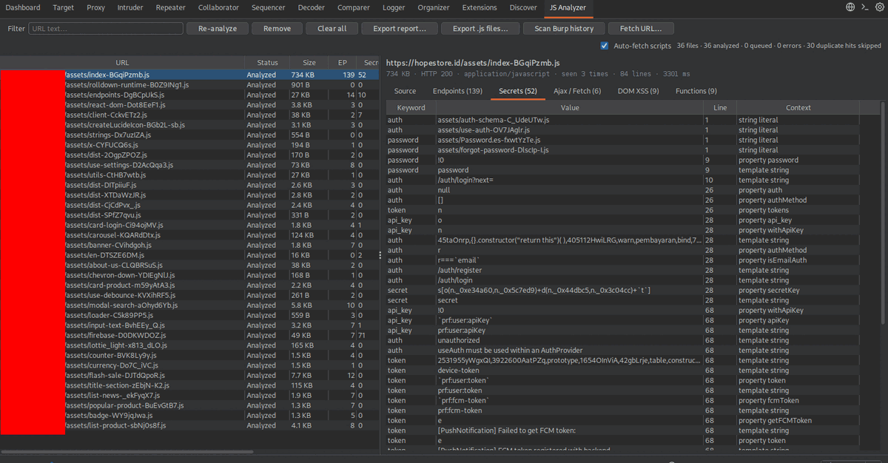

# JS Analyzer — Burp Suite extension

A native Burp Suite tab that passively collects every **in-scope JavaScript
file** seen in traffic, analyzes each file **once**, and shows the findings for
the file you click. It is a Java port of the analyzer in `../js-extractor`
(endpoints, sensitive keywords, Ajax/fetch/XHR parameters, action-named
functions, and potential DOM XSS flows).

```
Burp  ──►  HTTP handler  ──►  in-scope + JavaScript?  ──►  dedupe store  ──►  analyzer
                                                                              │
                                          "JS Analyzer" tab  ◄────────────────┘
                                          file list  +  findings tabs + source viewer
```

- Java 17 source, compiled to Java 17 bytecode
- Burp Suite 2024.7+ (Montoya API), tested with Burp Suite Community 2026.8
- No Maven or Gradle — one shell script builds the jar and runs the tests
- Everything stays in memory for the current Burp session; nothing is uploaded

## Screenshot



A live passive session: every in-scope bundle of a production site collected and
analyzed once (`36 files · 36 analyzed · 0 errors`). The 734 kB main bundle is
selected — 139 endpoints, 52 secret matches, 6 Ajax calls, 9 DOM XSS leads and
9 action-named functions — and its **Secrets** tab is open on the right.

## Contents

- [Screenshot](#screenshot)
- [Requirements](#requirements)
- [Build](#build)
- [Install in Burp](#install-in-burp)
- [What gets collected](#what-gets-collected)
- [Deduplication](#deduplication)
- [Using the tab](#using-the-tab)
- [Findings reference](#findings-reference)
- [Why a file shown in Sources may be missing](#why-a-file-shown-in-sources-may-be-missing)
- [Exporting the collected JavaScript](#exporting-the-collected-javascript)
- [Configuration](#configuration)
- [Project layout](#project-layout)
- [Tests](#tests)
- [Development notes](#development-notes)
- [Limitations](#limitations)
- [License](#license)

## Requirements

- Burp Suite **2024.7 or newer** (the extension uses the Montoya API).
  Tested against Burp Suite Community Edition **2026.8**.
- JDK 17+ to build. Burp provides the Montoya API at runtime, so the API jar is
  compile-only and is not bundled into the extension jar.

## Build

```bash
./build.sh          # produces dist/js-analyzer-burp.jar
./build.sh test     # also runs the engine and UI regression suites
```

The script downloads the Montoya API jar (compile-only) into `libs/` from
Maven Central. If you build offline, place the jar there yourself; the expected
filename is `libs/montoya-api-2024.7.jar`, and the version can be overridden
with the `MONTOYA_VERSION` environment variable.

The built jar contains only this extension's own classes plus the service
registration for `burp.api.montoya.BurpExtension`. Build output goes to
`build/` and `dist/`; neither directory is tracked by git.

## Install in Burp

1. **Extensions → Installed → Add**.
2. Extension type: **Java**.
3. Select `dist/js-analyzer-burp.jar`.
4. Make sure your target is in **Target → Scope**. Only in-scope traffic is
   collected.
5. Browse the target. A **JS Analyzer** tab appears in Burp's main tab bar.

The extension logs `JS Analyzer <version> loaded` (for example
`JS Analyzer 1.3.1 loaded`) to the extension Output tab, so you can confirm
which build Burp is actually running. If the tab
does not appear, check the Output/Errors tabs for a class-loading or
API-version error, and confirm the Burp version is 2024.7 or newer.

## What gets collected

A response is analyzed when all of these are true:

- the request URL is in Burp's target scope;
- the response status is 2xx and the body is not empty;
- the body is at most 8 MB;
- the URL path ends in `.js`, `.mjs`, `.cjs`, `.jsx` or `.es6`, **or** the
  `Content-Type` is JavaScript/ECMAScript/JScript;
- the body is not an HTML error page or JSON (`.map`, JSON MIME).

HTML responses are not analyzed as JavaScript, but they are still useful: when
**Auto-fetch scripts** is enabled, every in-scope HTML page that passes through
Burp is parsed for `<script src>` and `modulepreload` URLs, and any missing,
in-scope script is fetched through Burp's own HTTP stack (up to 60 per page,
two at a time, each URL tried once per session).

Both Burp's embedded browser and the other tools (Repeater, Scanner, etc.) feed
the same handler, because Burp routes all in-scope tool traffic through the HTTP
handler API. Requests are passed through untouched — the handler only reads
responses and always continues the exchange.

## Deduplication

Files are keyed by URL **without the query string**, so `app.js?v=1` and
`app.js?v=2` are one entry. When the same file is seen again:

- content fingerprint unchanged → the file is **not analyzed again**; it is
  only counted as a duplicate hit (status bar and `seen N times`);
- content changed → the entry is re-analyzed in place and its findings and
  source are replaced.

Each analysis runs on a background worker, so Burp's proxy is never blocked.
The store keeps two daemon worker threads at low priority and notifies the UI
when entries change. Analysis is linear in file size: a 670 KB minified bundle
takes ~0.7 s and an 8 MB bundle ~1.3 s on a normal desktop.

## Using the tab

The tab is a horizontal split: the collected-file list on the left, the detail
pane for the selected file on the right.

| Area | What it does |
|---|---|
| File list | URL, status, size, finding counts, hit count, analysis time. Sortable columns. |
| Filter | Case-insensitive substring filter on the URL. |
| Detail pane | Tabs for **Source**, **Endpoints**, **Secrets**, **Ajax / Fetch**, **DOM XSS**, **Functions**. |
| Double-click a finding row | Opens the Source tab, scrolls to and highlights the matching line. |
| Source tab | Read-only source viewer. Files with very long logical lines (minified bundles) are wrapped automatically so the code is actually visible. |
| Right-click a file | Copy URL, copy a text report for that file, re-analyze, remove, open URL in browser. |
| Ctrl+C in a findings table | Copies the selected rows as tab-separated text. |
| Re-analyze | Re-runs the analysis for the selected file without refetching it. |
| Remove / Clear all | Drops one entry or every entry from the current session. |
| Export report… | Writes a plain-text report of the findings for all collected files. |
| Export .js files… | Writes every collected JavaScript source into a folder (host/path structure), plus `_manifest.tsv` and `_report.txt`. |
| Scan Burp history | Re-scans Proxy history and the site map for stored JavaScript responses, with a reason breakdown for skipped entries. |
| Fetch URL… | Fetches a JavaScript URL through Burp's HTTP stack (bypassing browser and service-worker caches) and analyzes the response. |
| Auto-fetch scripts | Checkbox (on by default). When an in-scope HTML page passes through, missing `<script src>` files are fetched through Burp automatically. |
| Status bar | Total files, analyzed/queued/error counts, skipped duplicate hits, and in-flight auto-fetches. |

The file list columns are `URL`, `Status`, `Size`, `EP` (endpoints), `Secrets`,
`Ajax`, `XSS`, `Funcs`, `Hits`, `Time` (analysis duration). Counts are zero
while a file is still queued or if analysis failed.

Analysis results are kept in memory for the current Burp session only. They
survive switching tabs but not restarting Burp; use the exports if you need
them to persist.

## Findings reference

Every finding carries the line number in the original source. Double-clicking
the row jumps to it.

### Endpoints (`Endpoint` / `Type` / `Line`)

Endpoint-like strings recovered from the source:

- absolute URLs and protocol-relative URLs;
- relative paths (`/api/v1/users`);
- server-side routes ending in `.asp`, `.aspx`, `.ashx`, `.php`, `.jsp`,
  `.cgi`;
- API-looking paths.

`Type` is one of `absolute`, `server-script` (`.asp`, `.aspx`, `.ashx`,
`.php`, `.jsp`, `.cgi`), `api`, or `relative`, so you can sort by it. Treat the
list as an inventory of reachable routes, not as an authorization finding.

### Secrets (`Keyword` / `Value` / `Line` / `Context`)

Hits for `api_key`, `token`, `secret`, `admin`, `password`, `bearer` and
`auth` in variables, properties, assignments, string literals and template
strings. `Context` shows the surrounding expression so you can judge whether the
match is a real credential, a parameter name, or dead code. Keyword matching is
deliberately broad — expect false positives such as UI labels and config keys.

### Ajax / Fetch (`Type` / `Method` / `URL` / `Parameters` / `Line`)

Calls to `fetch()`, `$.ajax()` / `jQuery.ajax()` and `XMLHttpRequest`, with the
HTTP method, URL, and parameters recovered from the query string, an
object body, a `JSON.stringify` body or `FormData` fields. This is the fastest
way to enumerate API calls a bundle makes at runtime.

### DOM XSS (`Sink` / `Source` / `Severity` / `Confidence` / `Path` / `Line`)

Potential dataflow leads from attacker-influenced sources to HTML/script sinks:

- sources: `location.*`, `document.URL` / `referrer` / `cookie`, `event.data`,
  `localStorage` / `sessionStorage` reads;
- sinks: `innerHTML` / `outerHTML` / `srcdoc`, `insertAdjacentHTML`,
  `document.write`, `eval`, `new Function`, jQuery HTML methods, `setAttribute`,
  React `dangerouslySetInnerHTML`.

`Path` lists the assignment/aliasing steps between source and sink.
`Severity` and `Confidence` are heuristic. If the bundle contains DoMPurify or
Trusted Types usage on the path, it is reflected in the confidence. A source
that reaches a sink is a lead, not proof: confirm with a real payload in the
target's context.

### Functions (`Function` / `Action` / `Signature` / `Line`)

Functions whose names contain `upload`, `delete`, `rename`, `admin`, `execute`
or `create`, with their parameter signature and exact source range. Useful for
finding privileged operations and the code paths behind them.

## Why a file shown in Sources may be missing

The tab only contains files that reached Burp **while the extension was loaded
and the URL was in scope**, as a 2xx response with a body. A URL can appear in
the browser's Sources/site tree but never reach the handler when:

- the browser served it from its **disk/service-worker cache** (no response);
- it was loaded **before the extension was added**;
- the URL is **outside Burp's target scope**;
- Burp only saw a **304 Not Modified** (no body to analyze);
- the response was HTML/JSON, empty, or larger than 8 MB.

Entries are keyed without the query string, so `app.v5.js?id=54d...` is listed
as `.../js/app.v5.js` — search for `app.v5.js`, not the `?id=` part.

If Burp already holds the response, **Scan Burp history** imports it from
Proxy history or the site map, and reports why other entries were skipped
(no stored response, out of scope, status 304, empty body, not JavaScript).
The same skip reasons for JavaScript-looking responses are written to the
extension's Output tab (capped to avoid log noise).

If the file only exists in the browser cache or a **service-worker cache**,
Burp never receives a response, so neither live collection nor a history scan
can find it. Two automatic routes cover this:

- **Auto-fetch scripts** (on by default): every in-scope HTML page that passes
  through Burp is parsed for `<script src>` and `modulepreload` URLs. Scripts
  that are missing from the list and in scope are fetched through Burp's own
  HTTP stack, bypassing the service-worker cache. Up to 60 per page, two at a
  time, each URL tried once per session.
- **Scan Burp history** does the same for HTML pages already stored in Proxy
  history/site map.

If the page itself never passed through Burp, use **Fetch URL…** and paste the
script URL. A site-map node can also exist as a discovered URL with no stored
response — that is why it appears in Burp's tree but not in this tab.

## Exporting the collected JavaScript

**Export .js files…** asks for a target folder and writes:

```
js-analyzer-files/
  example.test/static/app.js
  example.test/static/app_2.js      (same path on another scheme/URL variant)
  _manifest.tsv                     (saved path, URL, status, counts, timestamps, hits)
  _report.txt                       (findings report for all files)
```

Paths are sanitized (`..` and special characters cannot escape the chosen
folder), missing extensions get `.js`, and collisions get a `_2`, `_3` suffix.
Files without a captured body are counted as skipped. `Export report…` only
writes the findings text, not the sources.

## Configuration

Keywords and interesting actions are constants at the top of
`src/main/java/jsanalyzer/engine/Analyzer.java`:

```java
SENSITIVE_KEYWORDS = List.of("api_key", "token", "secret", "admin", "password", "bearer", "auth")
INTERESTING_ACTIONS = List.of("upload", "delete", "rename", "admin", "execute", "create")
```

The size cap lives in `src/main/java/jsanalyzer/JsDetector.java`
(`MAX_BODY_BYTES = 8 MB`). Rebuild with `./build.sh` after editing.

## Project layout

```
src/main/java/jsanalyzer/
  BurpExtender.java          extension entry point: suite tab + HTTP handler
  TrafficListener.java       in-scope response inspection / HTTP handler
  JsDetector.java            JavaScript detection heuristics and size cap
  HtmlScriptExtractor.java   <script src> / modulepreload extraction
  ScriptAutoFetcher.java     background fetching of missing scripts
  ManualFetcher.java         "Fetch URL…" path through Burp's HTTP stack
  BurpHistoryImporter.java   Proxy history and site-map scan
  engine/JsLexer.java        tolerant JavaScript tokenizer
  engine/Analyzer.java       endpoints, secrets, Ajax, functions
  engine/DomXssAnalyzer.java DOM XSS dataflow
  store/AnalysisStore.java   dedupe, background analysis, listeners
  store/JsFile.java          one collected file
  model/                     finding records and AnalysisResult
  ui/AnalyzerTab.java        Burp suite tab and file list
  ui/DetailPanel.java        findings tabs and source viewer
  ui/FilesTableModel.java    file table model
  ui/ReportBuilder.java      text report export
  ui/SourceExporter.java     source folder export and manifest
src/test/java/jsanalyzer/    regression suites (plain Java, no JUnit)
docs/js-analyzer.png       screenshot used by this README
```

## Tests

`./build.sh test` runs the suites after building. Each prints
`passed: N, failed: 0` and exits non-zero on the first failure:

- `EngineTest` — 86 assertions mirroring the `js-extractor` test suite
  (endpoint classification, secrets, fetch/jQuery/XHR parsing, function ranges,
  DOM XSS flows, malformed-source fallbacks, modern syntax such as private
  fields and optional chaining);
- `BurpHistoryImporterTest` — 16 assertions covering Proxy history/site-map
  scanning, dedupe, scope filtering and skip-reason reporting;
- `ManualFetcherTest` — 11 assertions covering the manual fetch path, status
  handling and non-JavaScript rejection;
- `HtmlScriptExtractorTest` — 10 assertions covering script-tag extraction,
  URL resolution and de-duplication;
- `ScriptAutoFetcherTest` — 10 assertions covering automatic fetching, scope
  filtering, skip rules and the on/off switch;
- `SourceExporterTest` — 21 assertions covering file naming, path-traversal
  protection, collisions, and the exported manifest/sources;
- `UiSmokeTest` — 31 assertions covering dedupe, re-analysis on change, the
  file table, detail tabs, double-click line jump, minified-source wrapping,
  and JS detection.

The suites use a small plain-Java harness rather than JUnit, so the build has no
dependency beyond the JDK and the Montoya API jar. They run headless
(`-Djava.awt.headless=true`).

## Development notes

- **The engine is a tolerant tokenizer, not a parser.** It produces results for
  minified, modern or slightly malformed bundles. When the source cannot be
  fully tokenized, the UI shows a parser note and the findings are heuristic.
- **Never do work on the HTTP handler thread.** `TrafficListener` only decides
  whether a response is interesting and hands the body to `AnalysisStore`,
  which uses its own worker threads. Keep it that way: anything slow in the
  handler slows the whole proxy.
- **UI updates go through `AnalysisStore.Listener`.** Swing components are
  updated on the EDT; the store notifies listeners when entries change.
- **To add a detection rule**, extend the relevant pass in `Analyzer` (string
  and identifier walks, Ajax call detection, function discovery) or
  `DomXssAnalyzer` (source/sink tables and propagation), then add assertions to
  `EngineTest`. Line numbers must stay tied to the original source.
- **To change collection rules**, edit `JsDetector` / `TrafficListener`, and
  keep `BurpHistoryImporter` consistent — it applies the same rules to stored
  responses.
- The version in the jar manifest is set in `build.sh`
  (`Implementation-Version: 1.3.1`).

## Limitations

- Results are **leads, not confirmed vulnerabilities** — validate every finding
  in the target's context.
- Analysis state is in memory only; restarting Burp clears it.
- Only in-scope traffic is collected; out-of-scope responses are ignored even
  if they are JavaScript.
- Responses over 8 MB are skipped to keep the proxy responsive.
- HTML `/JSON` bodies and `.map` source maps are intentionally not analyzed.
- Browser-cached and service-worker-cached scripts never reach Burp unless
  auto-fetch, a history scan, or a manual fetch recovers them.
- Heuristic parsing can miss obfuscated/dynamically constructed code and can
  produce false positives on generated code.

## License

No license has been declared for this project yet. Add a `LICENSE` file before
distributing or publishing it.
